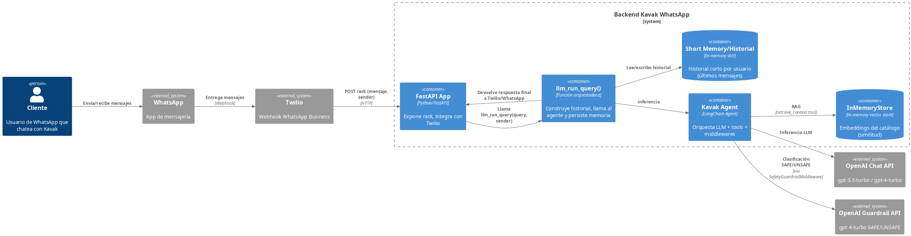
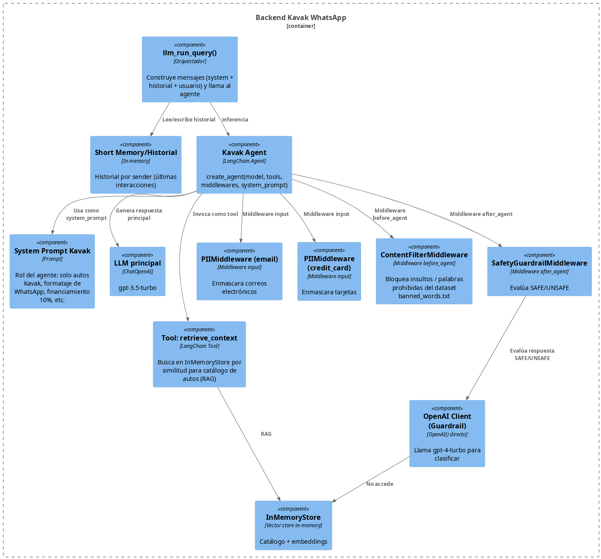

# CarDealership LLM agent

## Este agente soporta las siguientes caracteristicas:
- Apalanca uso de RAG para injeccion de contexto sobre catalogo
- Guarda memoria de conversaciones previas
- Ofrece y personaliza experiencia de usuarios ofreciendo ofertas del catalogo `sample_caso_ai_engineer.csv`
- Interactua por Whatsapp a traves de Twilio

## Setup rapido

1. Obtener key de OpenAI y guardar en .env (Copiar .env.template a .env en raiz)
2. Correr `make run`
3. Correr `make ngrok` y copiar URL generada (Finaliza con .ngrok-free.app)
4. Ir [Twilio Whatsapp Sandbox ](https://console.twilio.com/us1/develop/sms/try-it-out/whatsapp-learn?_gl=1*1ohbgtn*_ga*MTQwMjUxMDAyLjE3NjIzMTUwOTc.*_ga_RRP8K4M4F3*czE3NjIzMTU5MzMkbzEkZzEkdDE3NjIzMTcyODUkajQ1JGwwJGgw) y luego a *Sandbox Settings*
5. Remplazar campo **When a message comes in** con `https://<REMPLAZA>.ngrok-free.app/ask`
6. Dar de alta numero a Whatsapp Sandbox
7. Listo! Ya puedes probar este agente desde tu cuenta de Whatsapp!

## Diagrama de componentes

## Diagrama de pipeline de agente LLM

## Roadmap propuesto
## EPIC: CI/CD
Crear workflow en github actions para el siguiente flujo en caso de push a main y PR abierto:
- Linting de codigo
- Correr checks y escaners de codigo (sonarqube+trivy)
- Correr pruebas unitarias

Crear workflow en github actions para el siguiente flujo en caso de push a main:
- Desplegar API en ambiente dev
- Correr pruebas de integracion
- Correr pruebas de no regresion

### EPIC: Despliegue en produccion
- Desplegar en AWS ECS como container con estrategia canary.
- Exponer ALB que sirva API del container en el endpoint /ask.
- Crear CNAME de ALB endpoint en route53 con una politica de latencia para region mx-central-1 y us-west-1
- Registrar CNAME en Twilio como webhook de Whatsapp.

## EPIC: Tests de no regresion
- Desplegar en dev versiones A/B.
- Hacer A/B testing con benchmark y almacenar resultados en dataset.
- Enviar resultados a un modelo "LLM as judge". Comparar respuestas y dar comparativa. Se detecta en B un retroceso en comparacion a A?
- Evaluar desempeno de B en cuanto a las expectativas con mismo LLM as judge, tambien usar Human Interaction.
